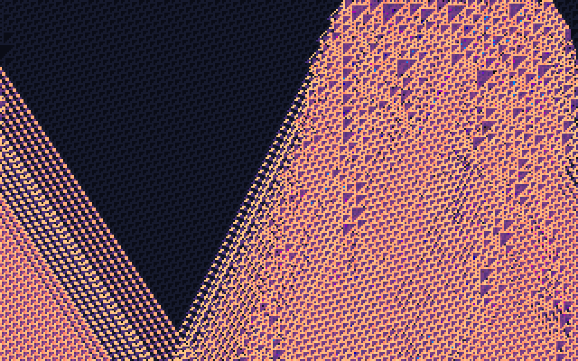
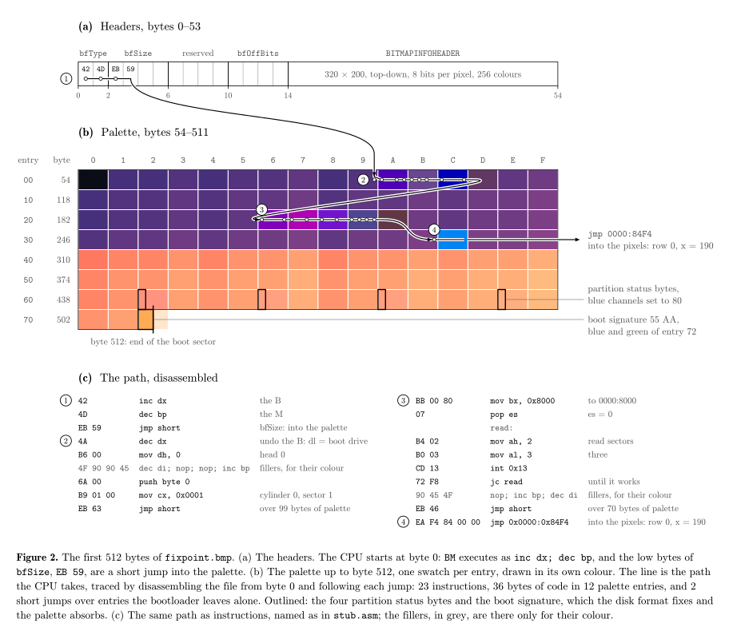

# fixpoint

an 88 KB image that boots and computes itself.

*a picture of its own consequences.*

**[watch it boot →](https://fixpoint.oddurs.com)**



`fixpoint.bmp` is an ordinary 320×200 bitmap. open it in anything and you get the picture above. write it to a disk and boot it, and the cpu draws the same picture again, from scratch, byte for byte, without looking. unzip it and it hands you its source.

```
qemu-system-i386 -drive format=raw,file=fixpoint.bmp
unzip fixpoint.bmp
```

on real hardware it needs a legacy bios, or uefi's compatibility mode, and vga. a uefi-only machine won't start it.

## what you're looking at

every row is the row above it, run through [rule 110](https://en.wikipedia.org/wiki/Rule_110), a one-dimensional cellular automaton that is turing-complete. the top row is where it starts: the last 130 pixels are the program, and the 190 before them are rule 110's **ether**, a background pattern that repeats every 14 cells and every 7 generations. the ether is the fabric of [matthew cook's proof](https://doi.org/10.25088/ComplexSystems.15.1.1) that rule 110 is universal: his gliders, the moving structures that carry information, travel through it. here, the only thing travelling is the program.

each pixel is a byte, so every cell holds eight rule 110 universes, one per bit. the ether is the same in all eight. the program's bits differ from universe to universe, so the program is the only thing that can make them disagree, and the palette shows exactly that:

- **where all eight universes agree**, the cell is `00` or `FF`, drawn in two close, quiet shades. this is the woven dark V: the universe exactly as it would have been if the program weren't there. it hasn't heard yet.
- **where they disagree**, the cell is in the program's causal future: its light cone. universe 6 decides whether it's light (coral to gold) or dark (indigo to plum), so its triangles show through, and the other seven set the hue.

every cell the program hasn't reached is dark, without exception. inside the cone, 0.93% of cells happen to agree anyway, and look dark too. they look untouched. they aren't.

the cone's edges move at about 0.63 cells per generation to the right and 0.49 to the left, close to the speeds of rule 110's two fastest gliders, which cook calls A and B: 2/3 and 1/2. the left cone is the program's influence leaving the right edge of the screen and coming back on the left, because the screen is one continuous tape. the diagonal stripes in it are glider trains. and the dark corner at the top right is the program's own last 14 bytes, which are one period of the ether, so the program ends in the fabric it disturbs.

the screen is treated as one tape, 64,000 cells long, folded into rows of 320. a cell's neighbours are the three cells 320 positions back, so there's no edge handling, and the whole computation is one loop:

```nasm
    mov di, 321             ; cell 320 has no left neighbour on the tape; it stays 0
.cell:
    mov al, [di-321]        ; left
    mov ah, [di-320]        ; centre
    mov dl, [di-319]        ; right
    mov bl, ah
    or bl, dl               ; c | r
    and al, ah
    and al, dl              ; l & c & r
    not al
    and al, bl              ; rule 110 = (c | r) & ~(l & c & r), on 8 bits at once
    stosb
    cmp di, 64000
    jb .cell
```

booting never reads the picture, apart from the 130 pixels that are the program. it doesn't need the rest. the bootloader loads three sectors: the header, the palette, and the first row of pixels. the program copies itself into the end of row 0, writes one period of the ether at the start and lets it copy itself across the rest of the row, then computes the other 63,680 pixels.

### what "fixpoint" means, exactly

the fixed point is the pixel array. the 64,000 bytes an image viewer draws are exactly the 64,000 bytes the program leaves in video memory, and the program is among them. the header and palette are loaded from the file, not computed. and the program finds its own bytes by reading them from memory, which a quine purist would call cheating. they'd be right. this isn't a quine; it's a file that contains its own output.

rule 110 being turing-complete is a property of the rule, not a claim about this picture: the seed is whatever bytes the program happens to be, so the universe isn't computing anything in particular. it just could.

## how one file is a picture, a disk, and an archive



| offset | as a bmp | as a disk |
|---|---|---|
| 0 | `BM` signature | `inc dx; dec bp` |
| 2 | file size: `EB 59 01 00` = 88,555 | `jmp short` into the palette |
| 6 | reserved, zero | |
| 54 | 256-colour palette | the bootloader, woven between colours |
| 446 | palette entries `0x62`–`0x71` | the partition table, with legal status bytes |
| 510 | palette entry `0x72` | `55 AA`, the boot signature |
| 1078 | pixels | row 0: the ether, then the program |
| 65,078 | padding, so the size field is true | a zip of the source, for `unzip` |

ask `file` what it is and it says `DOS/MBR boot sector`, with four partitions, all active. it doesn't mention the picture.

- **the file size is a jump instruction.** its low byte is `EB`, `jmp short`, and the next byte is the distance into the palette. the file is padded until the size it claims is true, and the padding holds a zip of `main.asm`, `stub.asm`, and `build.py`, so the file carries its own source.
- **the boot sector is palette colours.** the signature `55 AA` is the blue and green of entry `0x72`, and the four partition status bytes are blue channels, set to `80`, one of the two values a status byte may hold, because some bioses refuse a disk whose table holds anything else. all four say active, which a strict reading of the format wouldn't allow. all five entries have bit 6 set, so they're already warm colours: the boot sector moves them by at most 30 levels in any channel. the two bytes every bios looks for first are one of the oranges in the cone. they appear 107 times in the picture, if you know where to look.
- **the bootloader is woven into the palette.** its 36 bytes would otherwise be 36 wrong colours. `build.py` runs a dynamic program over instruction orders, alternate encodings, harmless fillers (`nop`, `inc bp`, `dec di`), and `jmp short` hops over colours it would rather leave alone, and picks the layout whose bytes disturb the picture least: 10 colours shift, about 1% of the pixels. the saturated blue and magenta specks you can find are the bootloader showing through; in figure 1 above, they're the swatches the traced path runs through. [`stub.asm`](stub.asm) writes out every palette entry it hops over, with its colour.
- **it doesn't care where it starts.** until its final far jump, the bootloader uses only relative jumps, so it runs the same whether the bios starts it at `0000:7C00` or `07C0:0000`.
- **it stays clear of the bpb.** a bios booting a usb stick as a floppy may rewrite bytes 11–61 in memory. nothing executable lives there, and the program reads the palette from a fresh copy off the disk.
- **it retries.** a failed disk read loops back to the read, instead of jumping into whatever happened to be in memory.
- **`B` is `inc dx`.** the bios leaves the boot drive number in `dl`, so the first thing the bootloader does is `dec dx`: it puts back what the `B` took, before it touches anything else in `dx`.

## build

needs `nasm`, python 3, and the packages in `requirements.txt`. verifying also needs `qemu-system-i386`, and uses ffmpeg and chrome when they're installed.

```
make            # build fixpoint.bmp, stub.asm, and the figures
make verify     # check every claim above, then boot it
make run        # boot it in a qemu window
make demo       # re-record the video (needs gdb and ffmpeg)
make site       # build the project page into site/build
```

`make verify` checks, with its own implementation of rule 110, that every row follows from the one above and that every cell the program hasn't reached is dark. it checks that pillow, ffmpeg, and chrome decode the same pixels; that the header, signature, and partition table are valid; and that the zip inside matches the source in the repo. then it boots the image in qemu and reads back video memory: all 64,000 bytes are the file's pixel bytes, and every pixel on screen is the image's colour, at the vga's 6 bits per channel. the build is deterministic, and ci rebuilds from source on every push, requires the committed image to be byte-identical, and runs the same checks.

| file | what it is |
|---|---|
| [`main.asm`](main.asm) | the program: palette setup, row 0, and the rule 110 loop |
| [`stub.asm`](stub.asm) | the bootloader, with the palette bytes it hops over. generated by `build.py`, committed so you can read it |
| [`build.py`](build.py) | lays out the file, runs the automaton, places the stub |
| [`verify.py`](verify.py) | checks every claim, then boots the image in qemu and reads back video memory |
| [`demo/record.py`](demo/record.py) | records the demo video: the bios in real time, then the computation under gdb, paused by a breakpoint on the program's own loop every two rows. every frame is the real screen |
| [`demo/figures.py`](demo/figures.py) | draws the figures in `docs/`, tracing the cpu's path by disassembling the file |
| [`site/`](site) | the [project page](https://fixpoint.oddurs.com), sveltekit, prerendered with no client-side js |

## lineage

files that are several things at once have a long, strange history; ange albertini's [funky file formats](https://fahrplan.events.ccc.de/congress/2014/Fahrplan/system/attachments/2562/original/Funky_File_Formats.pdf) is the map. the ether, the gliders, and the proof that they can compute anything are [matthew cook's](https://doi.org/10.25088/ComplexSystems.15.1.1).

## license

[mit](LICENSE)
