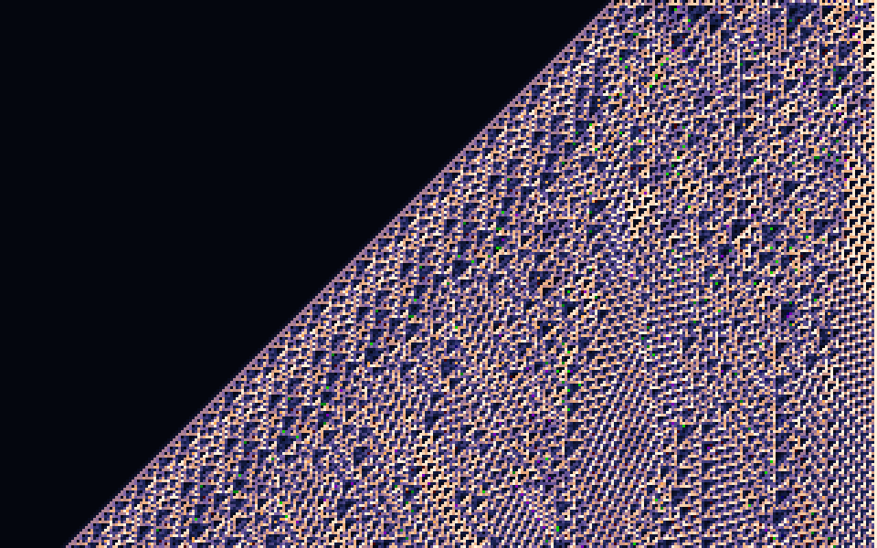

# fixpoint

a 66 KB image that boots and computes itself.

**[watch it boot →](https://oddurs.github.io/fixpoint)**



`fixpoint.bmp` is an ordinary 320×200 bitmap. open it in anything and you get the picture above. write it to a disk and boot it, and the cpu computes the same picture from scratch, pixel for pixel.

```
qemu-system-i386 -drive format=raw,file=fixpoint.bmp
```

## what you're looking at

the last 99 pixels of the top row are the program. every row below is the row above it, run through [rule 110](https://en.wikipedia.org/wiki/Rule_110), a one-dimensional cellular automaton that is turing-complete. the seed of the universe is the machine code that computes it.

each pixel is a byte, so every cell holds eight independent rule 110 universes, one per bit. the palette is a value ramp, so the high bits dominate: the big triangles are the top universe, and the seven below it are texture.

the screen is treated as one tape, 64,000 cells long, folded into rows of 320. a cell's neighbours are the three cells 320 positions back, so there is no edge handling, and the whole computation is one loop:

```nasm
.cell:
    mov al, [di-321]        ; left
    mov ah, [di-320]        ; centre
    mov dl, [di-319]        ; right
    mov bl, ah
    or bl, dl               ; c | r
    and al, ah
    and al, dl              ; l & c & r
    not al
    and al, bl              ; rule 110 = (c | r) & ~(l & c & r), on 8 bits at once
    stosb
    cmp di, 64000
    jb .cell
```

booting never reads the picture. it loads three sectors (the header, the palette, and the program), then re-derives the other 63,901 pixels. the file stores the program's output, and the output contains the program: run it and you get the image the file already is.

## how one file is two things

| offset | as a bmp | as x86 |
|---|---|---|
| 0 | `BM` signature | `inc dx; dec bp` |
| 2 | file size `EB 02 01 00` = 66,283 | `jmp short +2` |
| 6 | reserved | `jmp near` into the palette |
| 54 | 256-colour palette | entries 31–37 are the bootloader |
| 510 | palette entry 0x72 | `55 AA`, the boot signature |
| 1078 | pixels | row 0 ends with the program |

- the file size field is a jump instruction. the file is padded so the size it claims is true.
- the boot signature lives inside a palette colour. that entry is (255, 170, 85), so it shows up as an orange highlight in the picture.
- the bootloader's 25 bytes are also seven palette colours. `build.py` searches instruction orders, alternate encodings, and harmless filler instructions (`inc si`, `inc bp`, …) for the arrangement whose bytes, read as colours, sit closest to the ramp they replace. the green and magenta specks you can find are the bootloader showing through, about 1% of the image.
- the BIOS left the boot drive number in `dl`, and `B` is `inc dx`. the first thing the bootloader does is `dec dx`.

## build

needs `nasm` and python 3. checking it boots also needs `qemu-system-i386` and pillow.

```
make            # assemble main.asm, search for the stub, write fixpoint.bmp and stub.asm
make verify     # boot it in qemu, screenshot it, compare to the image: 64000/64000
make run        # boot it in a qemu window
```

the build is deterministic, and ci rebuilds from source on every push, checks the committed image is byte-identical, then boots it and compares every pixel.

| file | what it is |
|---|---|
| `main.asm` | the program: palette setup, the seed copy, and the rule 110 loop. assembled with `ORG` and `X0` defined, so it lands exactly at the end of row 0 |
| `stub.asm` | the bootloader in the palette. generated by `build.py`, committed so you can read it |
| `build.py` | lays out the file, runs the automaton, searches for the stub's colours |
| `verify.py` | boots the image in qemu and diffs the screen against the file |
| `demo/record.py` | records the demo video from real qemu frames, cpu throttled to ~1 MIPS |
| `site/` | the [project page](https://oddurs.github.io/fixpoint), sveltekit, prerendered with no client-side js |

## caveats

tested in qemu (seabios). real hardware may want a BIOS parameter block, and may not like a 66 KB disk image that isn't a whole number of sectors.

## license

[mit](LICENSE)
